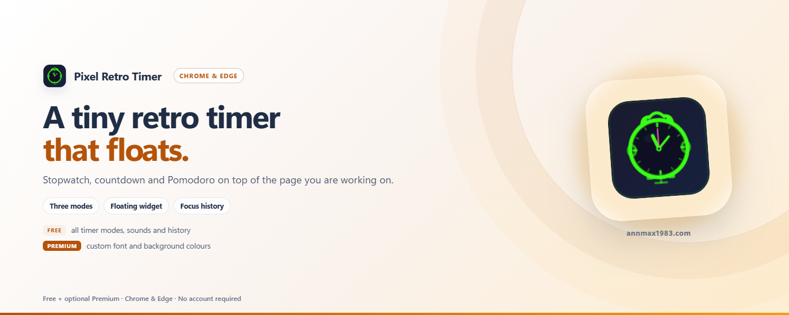

# RetroTime — Widget flotante de temporizador

[English](../README.md) | [中文](README_zh.md) | Español | [Deutsch](README_de.md) | [日本語](README_ja.md) | [Français](README_fr.md)

Un widget minimalista de temporizador flotante con efecto glassmorphism y modos de cronómetro, cuenta atrás y Pomodoro. Completamente sin conexión y sin rastreo; la única solicitud de red es la activación opcional de la licencia Pro.

> Chrome / Edge / Firefox · Manifest V3 · Sin rastreo · Sin conexión por defecto · Colores personalizables

---

## ¿Por qué RetroTime?

La mayoría de extensiones de temporizador se abren en una pestaña o popup aparte. RetroTime flota directamente sobre cualquier página web — arrástralo a donde quieras, se ajusta a los bordes, se minimiza cuando no lo necesitas.

| Ventaja | Detalle |
|---------|--------|
| ⏱️ **Triple modo** | Cronómetro, cuenta atrás personalizada y Pomodoro (ciclo trabajo+descanso) |
| 🖱️ **Arrastrar y ajustar** | Arrastre suave con ajuste a bordes y memoria de posición |
| 🔔 **Alertas y sonidos** | Notificaciones de escritorio, insignia de cuenta atrás en la barra de herramientas, 3 sonidos integrados (pitido, campana, suave) o sube el tuyo propio |
| 📊 **Historial** | Guarda automáticamente los temporizadores completados para hacer seguimiento de sesiones de concentración |
| 🎚️ **Control de opacidad** | Control deslizante de transparencia del 20% al 100% |
| 🔒 **Bloqueo y minimizar** | Bloquea la posición para evitar arrastres, minimiza a la barra de título |
| 🎨 **Colores personalizados** | Cambia el color de fuente y el color de fondo (Pro) |
| 🌍 **Multi-idioma** | EN, ZH, JA, DE, ES, FR |
| 🛡️ **Privacidad ante todo** | Sin rastreo ni analíticas; las funciones gratuitas no hacen peticiones de red |

---

## Gratis vs Pro

| Plan | Funcionalidades |
|------|----------|
| **Gratis** | Cronómetro, cuenta atrás, Pomodoro, todos los sonidos, control de opacidad, arrastrar y ajustar, bloqueo y minimizar, historial |
| **⭐ Pro** | Color de fuente personalizado, color de fondo personalizado |

Todas las funcionalidades del temporizador son gratuitas para siempre. Los **Colores personalizados** (color de fuente + color de fondo) requieren una licencia VKT Pro — una compra única que apoya el desarrollo.

- 🛒 Obtener licencia: `https://annmax1983.com/checkout?plugin=retrotime`
- ⚙ Activarla: abre el popup → haz clic en el botón **⚙** (arriba a la derecha) → introduce tu clave de licencia.

> La activación de licencia es **opcional**. El nivel gratuito funciona completamente sin ella.

---

## Vista previa

  

---

## Navegadores compatibles

| Navegador | Estado |
|---------|--------|
| Google Chrome | ✅ Totalmente compatible |
| Microsoft Edge | ✅ Totalmente compatible |
| Mozilla Firefox | ✅ Totalmente compatible |
| Otros navegadores basados en Chromium | ✅ Debería funcionar |

> **Nota sobre Firefox:** El resto de funciones se comporta igual que en Chrome / Edge.

---

## Instalación

| Tienda | Enlace |
|---|---|
| Chrome Web Store | [Instalar en Chrome](https://chromewebstore.google.com/detail/cdboleaglibdjbogeofpcaodilmbljgp) |
| Complementos de Microsoft Edge | [Instalar en Edge](https://microsoftedge.microsoft.com/addons/detail/fbpjlhjnggfpfeakomkllgljbpegajbd) |
| Complementos de Firefox (AMO) | [Instalar para Firefox](https://addons.mozilla.org/firefox/addon/pixel-retro-timer/) |

> Instale solo desde las tiendas oficiales de arriba; evite sitios de descarga de terceros.

---

## Uso

1. **Haz clic en el icono de la extensión** para abrir la configuración
2. **Activa el widget** con el interruptor de la cabecera (desactivado por defecto en la primera instalación)
3. **Selecciona el modo** — Cronómetro, Cuenta atrás o Pomodoro
4. **El widget del temporizador** aparece en la página — arrástralo a donde quieras
5. **▶ Iniciar / ⏸ Pausar / ↺ Restablecer** — botones de control en el widget
6. **⇄ Cambiar modo** — cicla entre modos en el widget
7. **🔒 Bloquear** — evita el arrastre accidental
8. **— Minimizar** — se colapsa solo a la barra de título
9. **🔔 Alertas de escritorio** — notificación del sistema cuando se acaba el tiempo (funciona aunque el navegador esté minimizado); el icono de la barra de herramientas muestra los minutos restantes

---

## Modos de temporizador

| Modo | Descripción |
|------|-------------|
| ⏱ **Cronómetro** | Cuenta ascendente desde 00:00, sin límite de tiempo |
| ⏳ **Cuenta atrás** | Establece minutos personalizados (preajustes de 10/25/30/60 o personalizado), cuenta regresiva hasta 00:00 |
| 🍅 **Pomodoro** | Duraciones personalizables de trabajo/descanso (por defecto 25min/5min), continuación automática opcional, saltar descanso |

---

## Privacidad

- **storage** — Guarda configuración, posición e historial localmente
- **alarms** — Dispara la finalización del temporizador puntualmente, aunque no haya ninguna pestaña visible
- **notifications** — Muestra la notificación de escritorio cuando un temporizador finaliza
- **Licencia (opcional)** — Solo si activas una licencia de pago: la clave de licencia y un identificador de instalación aleatorio se envían a `api.annmax1983.com` para activar/validar la licencia. Esto nunca incluye tus datos de temporizador ni historial de uso.
- Sin solicitudes de red para funcionalidades gratuitas — todo el procesamiento ocurre localmente
- Efectos de sonido generados en el navegador mediante Web Audio API
- [Política de privacidad](privacy-policy.html)

---

## Aviso de derechos de autor

Esta extensión proporciona una superposición local de temporizador flotante para comodidad del usuario. No modifica, copia ni redistribuye el contenido de ningún sitio web.

---

## Aviso sobre el código fuente

---

## Aviso sobre el código fuente

> ⚠️ **Este repositorio es solo para presentar el proyecto: el código fuente completo no se publica aquí.** Solo contiene la documentación de uso, las notas de versión y la información de soporte de la extensión.

> 📥 **Descárgala e instálala únicamente desde las tiendas oficiales de navegadores:** Chrome Web Store · Microsoft Edge Add-ons · Complementos de Firefox (AMO). Desde aquí no se distribuye ningún instalador sin conexión.

---

## Licencia

Copyright © 2026 RetroTime. Todos los derechos reservados.

Este software es propietario y de código cerrado. Sin autorización previa por escrito del autor, queda estrictamente prohibido descompilar, aplicar ingeniería inversa, crackear, modificar, reempaquetar, redistribuir o revender el programa (total o parcialmente).

---

## Enlaces

- **Sitio oficial:** https://annmax1983.com/
- **Esta extensión:** https://annmax1983.com/extensions/retrotime
- **Privacidad:** https://annmax1983.com/privacy
- **Contacto:** support@annmax1983.com
- **☕ Apoya el proyecto (Ko-fi):** https://ko-fi.com/annmax?ref=retrotime
