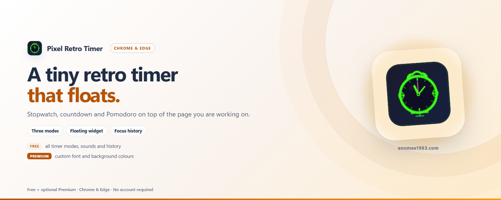

# RetroTime — Widget minuteur flottant

[English](../README.md) | [中文](README_zh.md) | [Español](README_es.md) | [Deutsch](README_de.md) | [日本語](README_ja.md) | Français

Un widget minuteur flottant minimalist en glassmorphism avec modes chronomètre, compte à rebours et Pomodoro. Entièrement hors ligne et sans suivi ; la seule requête réseau est l'activation facultative de la licence Pro.

> Chrome / Edge / Firefox · Manifest V3 · Aucun suivi · Hors ligne par défaut · Couleurs personnalisables

---

## Pourquoi RetroTime ?

La plupart des extensions de minuteur s'ouvrent dans un onglet ou un popup séparé. RetroTime flotte directement sur n'importe quelle page web — glissez-le où vous voulez, collez-le aux bords, minimisez-le quand vous n'en avez pas besoin.

| Avantage | Détail |
|-----------|--------|
| ⏱️ **Triple mode** | Chronomètre, compte à rebours personnalisé, Pomodoro (cycle travail + pause) |
| 🖱️ **Glisser et coller** | Déplacement fluide avec aimantation aux bords et mémorisation de la position |
| 🔔 **Alertes et sons** | Notifications bureau, badge de compte à rebours dans la barre d'outils, 3 sons intégrés (bip, carillon, doux) ou importez les vôtres |
| 📊 **Historique** | Sauvegarde automatique des minuteurs terminés pour suivre vos sessions de concentration |
| 🎚️ **Contrôle d'opacité** | Curseur de transparence de 20 % à 100 % |
| 🔒 **Verrouiller et minimiser** | Verrouillez la position pour éviter les déplacements, minimisez en barre de titre |
| 🎨 **Couleurs personnalisables** | Changez la couleur du texte et du fond (Pro) |
| 🌍 **Multilingue** | EN, ZH, JA, DE, ES, FR |
| 🛡️ **Confidentialité avant tout** | Aucun suivi ni analyse ; les fonctions gratuites ne font aucune requête réseau |

---

## Gratuit vs Pro

| Plan | Fonctionnalités |
|------|----------|
| **Gratuit** | Chronomètre, compte à rebours, Pomodoro, tous les sons, contrôle d'opacité, glisser et coller, verrouiller et minimiser, historique |
| **⭐ Pro** | Couleur de texte personnalisée, couleur de fond personnalisée |

Toutes les fonctionnalités de minuteur sont gratuites à vie. Les **Couleurs personnalisables** (couleur du texte + couleur de fond) nécessitent une licence VKT Pro — un achat unique qui soutient le développement.

- 🛒 Obtenir une licence : `https://annmax1983.com/checkout?plugin=retrotime`
- ⚙ L'activer : ouvrez le popup → cliquez sur le bouton **⚙** (en haut à droite) → saisissez votre clé de licence.

> L'activation de la licence est **optionnelle**. Le niveau gratuit fonctionne entièrement sans elle.

---

## Aperçu

  

---

## Navigateurs compatibles

| Navigateur | Statut |
|---------|--------|
| Google Chrome | ✅ Entièrement pris en charge |
| Microsoft Edge | ✅ Entièrement pris en charge |
| Mozilla Firefox | ✅ Entièrement pris en charge |
| Autres navigateurs basés sur Chromium | ✅ Devrait fonctionner |

> **Note Firefox :** Le reste des fonctions se comporte comme sous Chrome / Edge.

---

## Installation

| Store | Lien |
|---|---|
| Chrome Web Store | [Installer dans Chrome](https://chromewebstore.google.com/detail/cdboleaglibdjbogeofpcaodilmbljgp) |
| Microsoft Edge Add-ons | [Installer dans Edge](https://microsoftedge.microsoft.com/addons/detail/fbpjlhjnggfpfeakomkllgljbpegajbd) |
| Modules complémentaires Firefox (AMO) | [Installer pour Firefox](https://addons.mozilla.org/firefox/addon/pixel-retro-timer/) |

> Installez uniquement depuis les boutiques officielles ci-dessus — évitez les sites de téléchargement tiers.

---

## Utilisation

1. **Cliquez sur l'icône de l'extension** pour ouvrir les paramètres
2. **Activez le widget** avec le commutateur dans l'en-tête (désactivé par défaut à la première installation)
3. **Sélectionnez le mode** — Chronomètre, Compte à rebours ou Pomodoro
4. **Le widget minuteur** apparaît sur la page — glissez-le où vous voulez
5. **▶ Démarrer / ⏸ Pause / ↺ Réinitialiser** — boutons de contrôle sur le widget
6. **⇄ Changer de mode** — naviguez entre les modes sur le widget
7. **🔒 Verrouiller** — empêche les déplacements accidentels
8. **— Minimiser** — réduit à la seule barre de titre
9. **🔔 Alertes bureau** — notification système quand le temps est écoulé (fonctionne même quand le navigateur est minimisé) ; l'icône de la barre d'outils affiche les minutes restantes

---

## Modes de minuteur

| Mode | Description |
|------|-------------|
| ⏱ **Chronomètre** | Comptage à partir de 00:00, sans limite de temps |
| ⏳ **Compte à rebours** | Réglez les minutes personnalisées (préréglages 10/25/30/60 ou personnalisé), compte à rebours jusqu'à 00:00 |
| 🍅 **Pomodoro** | Durées de travail/pause personnalisables (par défaut 25min/5min), continuation automatique optionnelle, sauter la pause |

---

## Confidentialité

- **storage** — Sauvegarde les paramètres, la position et l'historique en local
- **alarms** — Déclenche la fin du minuteur à l'heure exacte, même quand aucun onglet n'est visible
- **notifications** — Affiche la notification de bureau quand un minuteur se termine
- **Licence (optionnelle)** — Uniquement si vous activez une licence payante : la clé de licence et un identifiant d'installation aléatoire sont envoyées à `api.annmax1983.com` pour activer/valider la licence. Cela n'inclut jamais vos données de minuteur ni votre historique d'utilisation.
- Pas de requêtes réseau pour les fonctionnalités gratuites — tout le traitement se fait en local
- Les effets sonores sont générés dans le navigateur via le Web Audio API
- [Politique de confidentialité](privacy-policy.html)

---

## Avertissement relatif au droit d'auteur

Cette extension fournit un overlay de minuteur flottant local pour la commodité de l'utilisateur. Elle ne modifie, ne copie ni ne redistribue aucun contenu de site web.

---

## Avis sur le code source

> ⚠️ **Ce dépôt sert uniquement à la présentation du projet — le code source complet n'y est pas publié.** Il ne contient que la documentation d'utilisation, les notes de version et les informations d'assistance de l'extension.

> 📥 **Téléchargement et installation uniquement depuis les boutiques officielles :** Chrome Web Store · Microsoft Edge Add-ons · Modules complémentaires Firefox (AMO). Aucun installateur hors ligne n'est distribué ici.

---

## Licence

Copyright © 2026 RetroTime. Tous droits réservés.

Ce logiciel est propriétaire et à code fermé. Sans autorisation écrite préalable de l'auteur, la décompilation, l'ingénierie inverse, le crackage, la modification, le reconditionnement, la redistribution ou la revente du logiciel (en tout ou en partie) sont strictement interdites.

---

## Liens

- **Site officiel:** https://annmax1983.com/
- **Cette extension:** https://annmax1983.com/extensions/retrotime
- **Confidentialité:** https://annmax1983.com/privacy
- **Contact:** support@annmax1983.com
- **☕ Soutenir le projet (Ko-fi):** https://ko-fi.com/annmax?ref=retrotime
