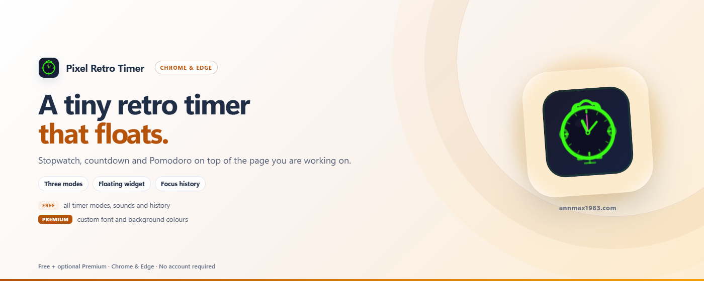

# RetroTime — 悬浮计时器组件

[English](../README.md) | 中文 | [Español](README_es.md) | [Deutsch](README_de.md) | [日本語](README_ja.md) | [Français](README_fr.md)

极简毛玻璃悬浮计时器，支持秒表、倒计时和番茄钟模式。完全离线，零数据收集。

> Chrome / Edge / Firefox · Manifest V3 · 无追踪 · 纯离线 · 可自定义颜色

---

## 为什么选择 RetroTime？

大多数计时器扩展需要打开新标签页或弹窗。RetroTime 直接悬浮在网页上——拖拽到任意位置，自动贴边吸附。

| 优势 | 说明 |
|------|------|
| ⏱️ **三种模式** | 秒表、自定义倒计时、番茄钟（工作+休息循环） |
| 🖱️ **拖拽贴边** | 丝滑拖拽体验，自动贴边吸附，位置记忆 |
| 🔔 **提醒与音效** | 桌面通知、工具栏倒计时角标，3 种内置音效 + 上传自定义音频 |
| 📊 **历史记录** | 自动保存完成的计时，追踪专注时间 |
| 🎚️ **透明度控制** | 20%-100% 透明度滑块 |
| 🔒 **锁定最小化** | 锁定位置防止误拖，最小化到标题栏 |
| 🎨 **自定义颜色** | 更改字体颜色和背景颜色（高级版） |
| 🌍 **多语言** | 英文、中文、日文、德文、西班牙文、法文 |
| 🛡️ **隐私优先** | 零数据收集，仅 `storage` + `alarms` + `notifications` 权限 |

---

## 免费 vs 付费

| 方案 | 功能 |
|------|------|
| **免费版** | 秒表、倒计时、番茄钟、全部音效、透明度、拖拽、锁定、历史 |
| **⭐ 高级版** | 自定义字体颜色、自定义背景颜色 |

所有计时功能永久免费。**自定义颜色**（字体+背景）需要 VKT 高级版许可证。

- 🛒 获取许可证：`https://www.annmax1983.com/checkout.html?plugin=retrotime`
- ⚙ 激活：打开弹窗 → 点击右上角 **⚙** 按钮 → 输入许可证密钥

> 许可证激活是**可选的**。免费版无需任何账户或许可证即可正常使用。

---

## 预览

  

---

## 支持的浏览器

| 浏览器 | 状态 |
|--------|------|
| Google Chrome | ✅ 完全支持 |
| Microsoft Edge | ✅ 完全支持 |
| Mozilla Firefox | ✅ 完全支持 |
| 其他 Chromium 内核浏览器 | ✅ 应该可以 |

> **Firefox 说明：** 其余功能与 Chrome / Edge 一致。

---

## 安装

| 商店 | 链接 |
|---|---|
| Chrome 应用商店 | [在 Chrome 中安装](https://chromewebstore.google.com/detail/cdboleaglibdjbogeofpcaodilmbljgp) |
| Microsoft Edge 加载项 | [在 Edge 中安装](https://microsoftedge.microsoft.com/addons/detail/fbpjlhjnggfpfeakomkllgljbpegajbd) |
| Firefox 附加组件（AMO） | 🔜 审核中，上架后补充链接 |

> 请只通过上方官方商店安装，避免使用第三方下载站。

---

## 使用方法

1. **点击扩展图标**打开设置
2. **打开顶部开关**启用悬浮组件（首次安装默认关闭）
3. **选择模式**——秒表、倒计时或番茄钟
4. **计时器组件**出现在页面上——拖拽到任意位置
5. **▶ 开始 / ⏸ 暂停 / ↺ 重置**——组件上的控制按钮
6. **⇄ 切换模式**——在组件上循环切换模式
7. **🔒 锁定**——防止误拖
8. **— 最小化**——折叠到标题栏
9. **🔔 桌面提醒**——计时结束发送系统通知（浏览器最小化也有效）；工具栏图标显示剩余分钟数

---

## 隐私

- **storage** — 本地保存设置、位置和计时历史
- **alarms** — 即使没有可见标签页，也能准点触发计时结束
- **notifications** — 计时结束时显示桌面通知
- **许可证（可选）** — 仅在激活付费许可证时发送许可证密钥和随机安装标识至 `api.annmax1983.com`
- 免费功能零网络请求——所有处理在本地完成
- 音效通过 Web Audio API 在浏览器内生成
- [隐私政策](../privacy-policy.html)

---

## 源码说明

> ⚠️ **此处不发布源码。** 本仓库仅提供使用说明、更新日志和留言支持服务。扩展程序仅通过 Chrome Web Store、Microsoft Edge Add-ons 与 Firefox 附加组件（AMO） 分发，不提供离线安装包或终端用户源代码。

---

## 许可证

Copyright © 2026 RetroTime. 保留所有权利。
